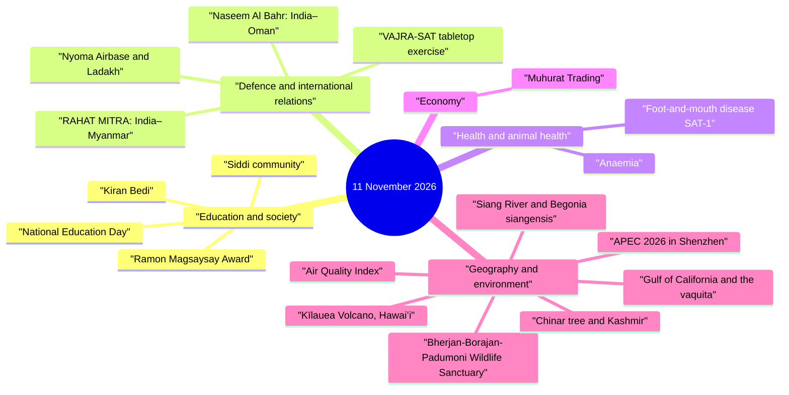

# 11 November 2026 -The Hindu and Nano Magazine By VeeR

### National Education Day

- Observed on: 11 November 2026
- Aim: to commemorate the birth
anniversary of Maulana Abul
Kalam Azad.
- Azad was independent India's
first education minister and
contributed significantly to
laying the foundation of
India's education system.
National Education Day
Basic Overview
- **Observed on:** 11 November every year
- **Purpose:** To highlight the importance of education and India's
progress in the education sector
- **Significance:** Marks the birth anniversary of Maulana Abul

### Kalam Azad, India’s first Education Minister

About Maulana Abul Kalam Azad
Served as Union Minister of Education (1947–1958)
Strong advocate of universal primary education
Promoted scientific learning & modern education
Key leader of the Indian National Movement and a senior INC
figure
National Education Day
Focus Areas
Digital Learning & EdTech
Inclusive & equitable education (NEP 2020 aligned)
Skill-based & modern curriculum development

### Significance

Reinforces the role of education in national
development

### Encourages literacy, awareness & innovation

Honors teachers, institutions & reformers who
shape society

## Score Booster

### Why in the news?

Khushbu Rajakbhai Darjada (15) won silver in the girls’ 63-kg judo category at the Dakar Youth
Olympics, becoming the second Indian judoka and first athlete from Gujarat’s Siddi community to win
a Youth Olympics medal.

### Quick recap

Khushbu Rajakbhai Darjada (15) won silver in the girls’ 63-kg judo category at the Dakar Youth Olympics, becoming
the second Indian judoka and first athlete from Gujarat’s Siddi community to win a Youth Olympics medal.

### Siddi Community

### Basic Overview

- **Community:** Siddis (also known as Habshi and Badsha).
- **Origin:** Descendants of people of African origin who migrated to India through historical movements,
including the Indian Ocean slave trade.
- **Historical Background:** Many Siddis arrived through Portuguese and other European trading
networks, while others came through Arab and African maritime connections.
- **Major States:** Gujarat, Karnataka and Maharashtra, particularly along India's western coast.
- **Ancestry:** The community has African ancestry and a distinct cultural identity.

### Constitutional and Tribal Status

- **Scheduled Tribe (ST):** Siddis are recognised as a Scheduled Tribe in specified states of India.
- **PVTG Status:** Siddi communities in Gujarat and Karnataka are included among India's Particularly
Vulnerable Tribal Groups (PVTGs).
- **Important:** ST recognition and PVTG identification are distinct classifications.

### Social Organisation

- **Family System:** Traditionally follows a nuclear family system, although extended families also exist.
- **Community Structure:** Maintains distinctive social customs and cultural traditions.
- **Cultural Identity:** Combines African cultural heritage with local Indian traditions.

### Why in the news?

An Indian Air Force (IAF) IL-76MD heavy-lift strategic transport aircraft made the world’s highest-
altitude landing of its kind at eastern Ladakh’s Mudh-Nyoma airbase.

### Quick recap

An Indian Air Force (IAF) IL-76MD heavy-lift strategic transport aircraft made the world’s highest-altitude landing of its kind at
eastern Ladakh’s Mudh-Nyoma airbase.

### Nyoma Airbase

- **Location:** Eastern Ladakh, Leh district, south of the Indus River.
- **Altitude:** Approximately 13,700 feet above sea level.
- **Strategic Location:** Approximately 46 km from the Line of Actual Control (LAC).
- **Nature:** High-altitude Advanced Landing Ground (ALG) upgraded into a full-fledged airbase.
- **Agency:** Indian Air Force (IAF).

### Key Features

- **Runway:** Approximately 3-km blacktopped runway, designed for fighter and heavy-lift aircraft operations.
- **Aircraft Capability:** Designed to support C-17 Globemaster III, IL-76, Su-30MKI and Rafale operations.
- **High-Altitude Airfield:** Among the world's highest fighter-capable airfields.
- **Infrastructure:** Includes hardened aircraft shelters, technical hangars, fuel-storage facilities and crash
barriers.
- **All-Weather Operations:** Infrastructure designed to support military aviation under extreme Himalayan
climatic conditions.

### Strategic Importance

China Border Security
Countering PLAAF
Rapid Deployment
Casualty Evacuation
Aerial Surveillance

### Quick recap

An Indian Air Force (IAF) IL-76MD heavy-lift strategic transport aircraft made the world’s highest-
altitude landing of its kind at eastern Ladakh’s Mudh-Nyoma airbase.

### Important Military Airfields in Ladakh

- **Leh:** Major military and civilian aviation hub.
- **Thoise:** Important military airbase supporting operations in northern Ladakh.
- **Kargil:** Strategic airfield in western Ladakh.
- **Nyoma:** Forward airbase strengthening India's operational reach in eastern
Ladakh.
- **Daulat Beg Oldi (DBO):** High-altitude Advanced Landing Ground near the northern
border.

### Significance for India

Strengthens India's forward airpower and strategic airlift capability.
Reduces logistical dependence on difficult mountain road networks.
Improves operational readiness, military mobility and rapid reinforcement along
the LAC.
Enhances India's ability to sustain military operations in eastern Ladakh.

### Why in the news?

Indian Naval Ship (INS) Surat reached Muscat, Oman to participate in the 15th edition of the bilateral
maritime exercise Naseem Al Bahr (Sea Breeze).

### Quick recap

Indian Naval Ship (INS) Surat reached Muscat, Oman to participate in the 15th edition of the bilateral maritime exercise
Naseem Al Bahr (Sea Breeze).

### Exercise Naseem Al Bahr

- **Nature:** Bilateral naval exercise between India and Oman.
- **Participating Countries:** Indian Navy and Royal Navy of Oman.
- **Initiation:** 1993.
- **Objective:** Strengthening maritime cooperation and the long-standing strategic partnership between
India and Oman.
- **Special Significance:** Oman was the first GCC country to conduct bilateral naval exercises with India.
- **Harbour Phase:** Includes professional interactions, cross-deck visits and sporting activities.
- **Sea Phase:** Focuses on operational interactions and maritime cooperation at sea.
- **Knowledge Exchange:** Enables both navies to exchange experiences and best practices.
- **Interoperability:** Enhances coordination and operational compatibility between the two navies.
- **Mutual Understanding:** Promotes professional relationships and cooperation between naval personnel.

### Strategic Significance

Strengthens India's maritime presence in the Arabian Sea and the wider Indian Ocean Region.
Reinforces the India–Oman strategic partnership.
Promotes maritime security and regional stability.
Enhances cooperation in ensuring the security of important sea lines of communication (SLOCs).

## International Relations

---

## Awards

---

## Health

---

### Anaemia

- **Definition:** A condition in which the haemoglobin (Hb) concentration in the blood is lower than the
normal level required to meet the body's physiological needs.
- **Primary Function Affected:** Reduced oxygen-carrying capacity of blood, resulting in inadequate
oxygen supply to body tissues.
- **Main Components Involved:** Red Blood Cells (RBCs), haemoglobin, iron, folate and vitamin B12.
- **Nature:** Anaemia is generally a sign of an underlying health condition, rather than an independent
disease.
- **Global Significance:** It is a major public health and nutritional challenge, particularly among
women, children and adolescent girls.
- **India:** Anaemia is an important concern under maternal and child health, nutrition and public
health programmes.
- **Key Diagnostic Parameter:** Haemoglobin concentration measured through a Complete Blood
Count (CBC) and other relevant investigations.
Normal Haemoglobin Levels and WHO
ClassificationWHO uses haemoglobin concentration to identify anaemia. The diagnostic
thresholds vary according to age, sex and physiological condition.
**WHO haemoglobin thresholds (2024 guideline)**
Population Group                                     Anaemia if Hb is Below
Children 6–23 months                                 10.5 g/dL
Children 24–59 months                                11.0 g/dL
Children 5–11 years                                  11.5 g/dL
Children 12–14 years                                 12.0 g/dL
Non-pregnant women (15–65 years)                     12.0 g/dL
Pregnant women                                       11.0 g/dL
Men (15–65 years)                                    13.0 g/dL
Types of Anaemia
**Based on the underlying cause**
- **Iron Deficiency Anaemia (IDA):** Caused by inadequate iron
availability, resulting in reduced haemoglobin synthesis. It is one of
the most common nutritional deficiencies worldwide.
- **Vitamin B12 Deficiency Anaemia:** Caused by inadequate vitamin
B12, affecting DNA synthesis and normal RBC maturation.
- **Folate Deficiency Anaemia:** Results from insufficient folic acid,
causing impaired DNA synthesis and abnormal RBC development.
- **Aplastic Anaemia:** Occurs when bone marrow fails to produce
sufficient blood cells, including RBCs, WBCs and platelets.
Types of Anaemia
**Based on the underlying cause**
- **Haemolytic Anaemia:** Characterised by premature destruction of
RBCs, exceeding the bone marrow's capacity to replace them.
- **Sickle Cell Anaemia:** An inherited disorder caused by a mutation
in the haemoglobin beta-globin gene, producing abnormal
haemoglobin S (HbS).
- **Thalassaemia:** An inherited blood disorder characterised by
reduced or absent production of alpha or beta globin chains.
- **Anaemia of Chronic Disease:** Associated with chronic infections,
inflammation, kidney disease and certain cancers.
Causes and Risk Factors
**Major causes of anaemia**
- **Nutritional Deficiency:** Insufficient intake or absorption of
iron, vitamin B12 and folate.
- **Blood Loss:** Excessive menstrual bleeding,
gastrointestinal bleeding, injuries, surgery and childbirth.
- **Parasitic Infections:** Hookworm and malaria can contribute
to anaemia through blood loss or destruction of RBCs.
- **Genetic Disorders:** Sickle cell disease, thalassaemia and
other inherited haemoglobin disorders.
Causes and Risk Factors
**Major causes of anaemia**
- **Chronic Diseases:** Chronic kidney disease, tuberculosis,
HIV, inflammatory disorders and cancers.
- **Pregnancy:** Increased iron and folate requirements due to
expansion of maternal blood volume and foetal development.
- **Poor Dietary Diversity:** Low consumption of iron-rich foods and
diets containing substances that inhibit iron absorption.
- **Malabsorption:** Conditions affecting intestinal absorption,
including coeliac disease and certain gastrointestinal disorders.
Symptoms and Health Consequences
**Common symptoms**
- **Fatigue and weakness:** Reduced oxygen supply to body tissues.
- **Dizziness:** Particularly during physical activity or sudden changes in posture.
- **Rapid heartbeat:** Heart compensates for reduced oxygen-carrying capacity.
- **Shortness of breath:** Especially during physical exertion.
- **Pale skin and conjunctiva:** Reduced haemoglobin may produce pallor.
- **Poor concentration:** Reduced oxygen delivery can affect cognitive performance.
- **Cold hands and feet:** May occur due to impaired oxygen delivery.
- **Brittle nails:** Sometimes associated with iron deficiency.
Symptoms and Health Consequences
**Major consequences**
- **Cognitive Development:** Iron deficiency during early childhood can adversely affect
brain development, learning and cognitive performance.
- **Educational Performance:** Anaemia may reduce attention, memory and academic
productivity.
- **Maternal Health:** Increases the risk of maternal complications and reduces the
ability to tolerate blood loss during childbirth.
- **Foetal Development:** Maternal anaemia is associated with increased risks of preterm
birth and low birth weight.
- **Economic Productivity:** Reduces physical work capacity and labour productivity.
- **Immune Function:** Nutritional deficiencies can impair normal immune functioning.

### Iron Deficiency Anaemia — Important Concepts

- **Iron:** An essential micronutrient required for haemoglobin synthesis.
- **Haemoglobin:** Iron-containing protein present in RBCs that
transports oxygen.
- **Ferritin:** Intracellular iron-storage protein; serum ferritin is
commonly used to assess iron stores.
- **Transferrin:** Plasma protein responsible for transporting iron in the
blood.
- **Bone Marrow:** Primary site of RBC production through a process known
as erythropoiesis.

### Diagnosis and Investigations

- **Complete Blood Count (CBC):** Measures haemoglobin, RBC count, haematocrit
and other blood parameters.
- **Mean Corpuscular Volume (MCV):** Indicates the average size of RBCs.
- **Serum Ferritin:** Helps assess the body's iron stores; it may rise during inflammation.
- **Peripheral Blood Smear:** Examines the size, shape and appearance of RBCs.
- **Reticulocyte Count:** Measures immature RBCs and helps assess bone marrow
response.
- **Serum Vitamin B12 and Folate:** Used to investigate suspected vitamin deficiencies.
- **Haemoglobin Electrophoresis/HPLC:** Helps identify haemoglobin variants and
disorders such as sickle cell disease and thalassaemia.

### ANSWER - B

- **Correct Answer:** (b) 1, 3 and 4 only

### Detailed Explanation

- Statement 1 — Correct: Iron deficiency anaemia is generally characterised by microcytic hypochromic
RBCs. Microcytic refers to smaller-than-normal red blood cells, while hypochromic indicates reduced
haemoglobin content. Iron is essential for haemoglobin synthesis; its deficiency results in reduced
haemoglobin production and smaller RBCs.
- Statement 2 — Incorrect: Serum ferritin generally decreases in iron deficiency because ferritin reflects
the body's iron stores. However, ferritin is also an acute-phase reactant. During chronic inflammation,
infections or certain diseases, ferritin levels may remain normal or become elevated despite underlying iron
deficiency. Therefore, ferritin cannot always be interpreted independently of inflammatory status.
- Statement 3 — Correct: Hepcidin is a peptide hormone produced mainly by the liver. It regulates
systemic iron metabolism by binding to ferroportin, an iron-export protein. This causes ferroportin
internalisation and degradation, thereby reducing intestinal iron absorption and iron release from
macrophages and liver stores.
- Statement 4 — Correct: Vitamin B12 is essential for normal DNA synthesis and RBC maturation. Its
deficiency leads to impaired cell division, resulting in enlarged red blood cells known as macrocytes and may
cause megaloblastic anaemia. Neurological complications such as numbness and impaired balance may also
occur.

### Exercise VAJRA-SAT

- **Nature:** A National Tabletop Exercise focused on preparedness
against Foot-and-Mouth Disease (FMD), particularly serotype SAT-
1.
- **Disease Focus:** Foot-and-Mouth Disease (FMD) serotype SAT-1.
- **India's Status:** FMD serotype SAT-1 has not been reported in India.
- **Primary Objective:** To strengthen national preparedness and
coordinated responses to transboundary animal diseases.

### Theme: “Detect Early, Confirm Fast, Contain Together.”

### Organising Institutions

- **Lead Organisation:** Department of Animal Husbandry
and Dairying (DAHD), Government of India.
- **Technical Coordination:** Indian Council of Agricultural
Research–National Institute of Veterinary Epidemiology
and Disease Informatics (ICAR-NIVEDI), Bengaluru.
- **Collaborative Approach:** Involved veterinary
laboratories, universities, vaccine manufacturers,
national institutions and defence and border-guarding
agencies.

### Background and Significance

- **Geographical Spread:** FMD serotype SAT-1 has historically been associated
with Africa and has spread beyond Africa to parts of West Asia.
- **Emerging Threat:** Its geographical expansion raises concerns about the
possible introduction of the serotype into India.
- **Livestock Protection:** The exercise was undertaken as a proactive
preparedness initiative to protect livestock health.
- **Farmers' Livelihoods:** An outbreak could adversely affect farmers' incomes,
livestock productivity and animal-based economic activities.
- **National Importance:** Strengthening preparedness helps protect India's
livestock economy and reduces the risk of cross-border disease transmission.

### Participants and Coverage

- **Total Participants:** 83 participants.
- **Geographical Representation:** 25 States and 3 Union Territories.
**Participating Institutions and Agencies**
National institutions.
Veterinary diagnostic laboratories.
Universities and research institutions.
Vaccine manufacturers.
Defence and border-guarding agencies.
- **Importance:** Promoted coordination among central and State-level
institutions for managing potential animal disease outbreaks.

### Key Features of the Exercise

**Tabletop Simulation**
- Participants discussed simulated FMD SAT-1 outbreak scenarios.
- The exercise focused on decision-making, institutional coordination
and emergency response rather than an actual field outbreak.
**Early Detection and Surveillance**
- Strengthening disease surveillance and early identification of
suspected infections.
- Improving timely reporting of unusual disease events.
**Laboratory Confirmation**
- Emphasised rapid and accurate laboratory diagnosis.
- Strengthened coordination between veterinary laboratories and disease
surveillance agencies.
Epidemiological Investigation and Animal Movement Control:
- Discussed tracing possible sources of infection and identifying disease
transmission pathways.
- Focused on controlling animal movement to prevent geographical spread.
**Emergency Vaccination**
- Highlighted the importance of vaccine readiness and emergency
vaccination strategies.
- Emphasised preparedness for rapid vaccination during an outbreak.
**Risk Communication**
- Focused on timely communication among government agencies,
veterinarians, livestock owners and other stakeholders.
- Helps prevent misinformation and supports coordinated disease
control.

### Key Recommendations and Outcomes

- **Timely Reporting:** Strengthen early reporting of suspected animal
disease outbreaks.
- **Rapid Diagnosis:** Improve laboratory capacity and speed of disease
confirmation.
- **Vaccine Readiness:** Ensure preparedness for emergency vaccination.
- **Inter-State Coordination:** Improve information-sharing and
coordinated action among States and Union Territories.
- **Integrated Response:** Strengthen cooperation among veterinary
institutions, government agencies and border authorities.

### Correct Answer: (b) Only two statements

**Statement 1 is Correct**
Exercise VAJRA-SAT was a National Tabletop Exercise focused on preparedness against Foot-and-Mouth Disease (FMD) serotype SAT-1.
Its primary purpose was to strengthen India's preparedness and coordinated response to potential outbreaks of transboundary animal
diseases.
The exercise involved simulated outbreak scenarios to examine early detection, laboratory confirmation, epidemiological investigation and
animal movement control.
It also emphasised emergency vaccination, disease surveillance and risk communication.
A tabletop exercise primarily involves scenario-based discussions and decision-making, rather than conducting an actual field operation.
**Statement 2 is Incorrect**
The statement incorrectly identifies the lead organising institution and the nature of the exercise.
The exercise was organised by the Department of Animal Husbandry and Dairying (DAHD) in coordination with ICAR–National Institute
of Veterinary Epidemiology and Disease Informatics (ICAR-NIVEDI), Bengaluru.
It was a tabletop preparedness exercise, not a live field vaccination campaign.
Its focus was on improving institutional coordination, outbreak response mechanisms, rapid diagnosis and emergency preparedness.
**Statement 3 is Correct**
FMD serotype SAT-1 has not been reported in India, according to the information provided.
SAT-1 has historically been associated with Africa, but its geographical spread beyond Africa to parts of West Asia has raised concerns
about its possible introduction into India.
Therefore, VAJRA-SAT was undertaken as a proactive preparedness initiative.
Its broader objective was to safeguard livestock health, farmers' livelihoods and India's livestock economy.

## Economy

---

### Muhurat Trading

- **Meaning:** A special, pre-scheduled and shortened trading session conducted by
Indian stock exchanges on the occasion of Diwali (Lakshmi Puja).
- **Organised by:** Bombay Stock Exchange (BSE) and National Stock Exchange
(NSE).
- **Traditional Significance:** It marks the beginning of the Hindu financial year,
associated with Vikram Samvat.
- **Duration:** Generally, the main trading session lasts approximately one hour,
although the exact timings are notified by the exchanges every year.
- **Objective:** To symbolically welcome the new Samvat year and seek
prosperity, wealth and financial well-being (Shubh Labh).

### Background and Historical Evolution

**Traditional Origin – Chopda Pujan**
- Muhurat Trading is rooted in the traditional practice of Chopda Pujan, followed
particularly by Gujarati and Marwari business communities.
- Traders traditionally close their old account books and worship new account books
(Chopda) on Diwali.
- The ritual is associated with Goddess Lakshmi, the deity of wealth, and Lord
Ganesha, associated with prosperity and auspicious beginnings.
**BSE – 1957**
- The Bombay Stock Exchange institutionalised Muhurat Trading as an organised
stock-market session in 1957.
**NSE – 1992**
- The National Stock Exchange adopted the practice in 1992.
- Trading gradually transitioned from traditional open-outcry systems to electronic
trading platforms.

### How Muhurat Trading Works

- **Special Trading Schedule:** Exchanges notify a separate trading schedule for Diwali,
outside normal market timings.
- **Pre-Opening Session:** A preliminary session helps determine the opening price
of securities.
- **Normal Trading Session:** A short continuous trading window, generally
lasting around one hour, allows investors to buy and sell securities.
- **Closing Session:** A closing session follows the main trading window according to the
exchange's notified schedule.
- **Multiple Segments:** Depending on the exchange's annual schedule, trading may be
available in: Equity segment, Equity derivatives, Currency derivatives,

### Commodity derivatives

- **Festive Market Sentiment:** Muhurat Trading is traditionally associated with positive
investor sentiment. However, markets are not guaranteed to close in the green.
- **Token Investment:** Many investors make symbolic purchases of shares, gold-related
assets or ETFs to mark the beginning of the new financial year.
- **Blue-Chip Investments:** Investors may prefer financially established companies and
long-term investment opportunities.
- **Portfolio Reallocation:** Investors sometimes rebalance their portfolios or initiate fresh
investments during the session.
- **Digital Chopda Pujan:** Traditional opening of physical account books has increasingly been
complemented by the first digital trades and portfolio additions of the new Samvat year.
- **Auspicious Timing:** The session is generally scheduled around the auspicious period of
Lakshmi Puja, with exact timings announced by the exchanges.
Significance of Muhurat Trading
- **Cultural Significance:** Reflects the integration of India's traditional
business practices with its modern financial markets.
- **Investor Participation:** Encourages retail investors to participate in the
stock market.
- **Financial Awareness:** Provides an opportunity to promote investment
awareness and long-term wealth creation.
- **Market Tradition:** Strengthens the relationship between investors, brokers
and stock exchanges through a shared annual tradition.
- **Symbolic Beginning:** Represents a fresh start for investment activities
during the new Samvat year.

### ANSWER - A

### Correct Answer: (a) Only 1

- Statement 1 is Correct:
Muhurat Trading is a special, shortened trading session organised by the BSE and NSE on the occasion
of Diwali (Lakshmi Puja).
It symbolically marks the beginning of the traditional Hindu financial year known as Vikram Samvat.
The session is considered auspicious for initiating new investments and seeking prosperity and financial
well-being.
It generally includes a pre-opening session, a short continuous trading window and a closing session.
The exact date and timings are notified by the stock exchanges every year.
- Statement 2 is Incorrect:
The statement has reversed the historical sequence of institutionalisation.
The Bombay Stock Exchange (BSE) first institutionalised Muhurat Trading as an organised exchange
session in 1957.
The National Stock Exchange (NSE) adopted the practice later, in 1992.
Therefore, NSE was not the first exchange to introduce the organised session.

### Gulf of California

### Major Gulfs of America

- **Location:** Situated between the Baja California Peninsula and mainland Mexico.
- **Country:** Entirely bordered by Mexico.
- **Water Body:** A marginal sea of the Pacific Ocean.
- **Alternative Name:** Also known as the Sea of Cortez.
- **Extent:** Extends from the Colorado River Delta in the north to the Pacific Ocean in the south.

### Geographical Features

- **Islands:** Includes important islands such as Tiburón Island, the largest island in the gulf, and Ángel de
la Guarda Island.
- **Rivers:** The Colorado River historically drained into its northern part, forming an extensive delta.
- **Geology:** Located in an active tectonic region associated with the Gulf of California Rift Zone and
the East Pacific Rise.
- **Biodiversity:** Rich in marine life, including whales, dolphins, sea lions and whale sharks.
- **Endemic Species:** Home to the critically endangered Vaquita, a small porpoise found only in this gulf.

### Economic & Environmental Importance

- **Fisheries:** Supports major commercial and artisanal fisheries.
- **Trade:** Important for maritime transport, ports and coastal commerce.
- **UNESCO Recognition:** The Islands and Protected Areas of the Gulf of California were
designated a UNESCO World Heritage Site in 2005.
- **Conservation Threats:** Faces overfishing, bycatch, habitat degradation and marine pollution.
- **Vaquita Conservation:** Accidental capture in gillnets is a major threat to its survival.

### RAMON MAGSAYSAY AWARD

### 1. Basic Identity

An annual award established in 1957 in honour of Ramon Magsaysay, former President of the
Philippines.
It is often regarded as Asia’s highest honour for individuals and organisations demonstrating
selfless service and transformative leadership.
The award recognises outstanding contributions to public service, community leadership,
journalism, peace, and social change.

### 2. Ramon Magsaysay — Key Facts

Ramon Magsaysay served as the 7th President of the Philippines from 1953 to 1957.
He was known for promoting democratic governance, integrity in public service, and a
people-centred administration.
He died in an aircraft crash in 1957, and the award was established in the same year.

### 3. Award & Categories

The award is administered by the Ramon Magsaysay Award Foundation (RMAF) based in
Manila, Philippines.
The original categories included Government Service, Public Service, Community
Leadership, Journalism/Literature/Creative Communication Arts, and Peace &
International Understanding.
The award primarily recognises Asian individuals and organisations whose work has created a
significant positive impact on society.

### Ramon Magsaysay Awardee from India

### Kiran Bedi

### Basic Identity

- **Born:** 9 June 1949, Amritsar, Punjab.
India's first woman officer of the Indian Police Service
(IPS), joining the service in 1972.
Former tennis player and social activist.
Served as the 24th Lieutenant Governor of Puducherry
(2016–2021).

### Police & Prison Reforms

Introduced innovative approaches to community policing and police administration.
Served as Inspector General of Prisons at Tihar Jail, Delhi.
Introduced prison reforms focusing on education, meditation, vocational training and
rehabilitation.
Promoted Vipassana meditation among prison inmates.
Established Navjyoti India Foundation (1987) to address drug abuse, crime prevention and social
development.
Founded the India Vision Foundation (1994) to support prison reform, rehabilitation and
community development.

### Ramon Magsaysay Award

- **Year:** 1994.
- **Category:** Government Service.
Recognised for her innovative leadership in police administration, prison reforms and efforts to
make law enforcement more responsive to citizens.

### Other Honours & Legacy

- **United Nations Medal:** 2004, for service in the United Nations Civilian Police.
Served as a United Nations Police Adviser in the Department of Peacekeeping Operations
(2003–2005).
Authored books including I Dare! and It's Always Possible.
Remembered for promoting accountability, rehabilitation and citizen-oriented policing.
WORD                                       MEANING AND SYNONYMS                                       ANTONYMS
Ebb (verb)           (of an emotion or quality) gradually lessen or reduce.                              ascent, rise,
diminish, dwindle, wane
- **Sentence:** Every tide has its ebb.
Ascendancy           occupation of a position of dominant power or influence.                            impotence,
- **Sentence:** He slowly gained ascendancy in the group.
Pagan (noun)         a person holding religious beliefs other than those of the main world religions.    religious, sacred
heathen, infidel, idolater
- **Sentence:** The temple was built by pagans in the 4th century as a place to worship
their idols.
Inimitable           so good or unusual as to be impossible to copy; unique.                             common,
Valorous             showing great courage in the face of danger, especially in battle.                  coward,

### ANSWER - C

### Correct Answer: (c) Myanmar

Detailed Explanation
Exercise RAHAT MITRA is the inaugural bilateral tri-services Humanitarian Assistance and Disaster Relief (HADR)
exercise conducted between India and Myanmar.
The exercise was held in Chennai, Tamil Nadu.
It aims to strengthen cooperation between the armed forces of both countries in responding to natural disasters and
humanitarian emergencies.
It focuses on improving joint operational coordination, interoperability, disaster-response capabilities and
humanitarian assistance mechanisms.
The participation of all three services — Indian Army, Indian Navy and Indian Air Force — highlights its tri-services
character.
Why the Other Options Are Incorrect
(a) Bangladesh: India and Bangladesh conduct several bilateral defence cooperation activities, but Bangladesh is
not the partner country for Exercise RAHAT MITRA.
(b) Sri Lanka: India and Sri Lanka undertake maritime and military cooperation exercises, including SLINEX and
MITRA SHAKTI.
(d) Maldives: India and Maldives conduct joint military exercises such as EKUVERIN.
- **Prelims Takeaway:** Exercise RAHAT MITRA → India–Myanmar | Chennai | Tri-services HADR Exercise.
- **Correct Answer:** (b) "Together for Humanity, Stronger through Partnership"
Detailed Explanation
The official theme of the India–Myanmar bilateral tri-services HADR exercise RAHAT MITRA was "Together for
Humanity, Stronger through Partnership."
The theme reflects the shared commitment of India and Myanmar towards humanitarian cooperation and disaster
management.
The exercise aims to strengthen bilateral defence cooperation and improve coordination during natural disasters
and humanitarian emergencies.
It emphasises joint preparedness, interoperability, coordinated response and mutual assistance between the armed
forces of both countries.
The participation of the Indian Army, Indian Navy and Indian Air Force makes it a tri-services exercise.
Why the Other Options Are Incorrect
(a) United for Relief, Resilient for Tomorrow: This was not the official theme of Exercise RAHAT MITRA.
(c) Bridges of Friendship, Oceans of Hope: This is not the officially announced theme of the exercise.
(d) Security and Growth for Regional Resilience: This is not the official theme associated with Exercise RAHAT
MITRA.
- **Prelims Takeaway:** Exercise RAHAT MITRA → India–Myanmar | Chennai | Tri-services HADR Exercise |

### Theme: "Together for Humanity, Stronger through Partnership."

### Correct Answer: (a) Hawaiʻi Island, United States

Detailed Explanation
Kīlauea Volcano is an active shield volcano located on the southeastern part of Hawaiʻi Island, in the United
States.
It is situated within Hawaiʻi Volcanoes National Park and is one of the most active volcanoes in the world.
Kīlauea is a hotspot volcano, formed due to the movement of the Pacific Plate over a relatively stationary
mantle hotspot.
It is characterised by frequent basaltic lava eruptions, lava flows and spectacular lava-fountaining episodes.
Kīlauea is part of the Hawaiian–Emperor volcanic chain, which was formed by the movement of the Pacific
Plate over the Hawaiian hotspot.
Its eruptions provide important insights into volcanic processes, mantle hotspots and basaltic volcanism.
Why the Other Options Are Incorrect
(b) Sicily, Italy: Sicily is home to Mount Etna, one of Europe's most active volcanoes.
(c) Kamchatka Peninsula, Russia: This region contains several active volcanoes, including Klyuchevskoy
Volcano.
(d) North Island, New Zealand: It contains volcanic features such as Mount Ruapehu and Mount Ngauruhoe.
- **Prelims Takeaway:** Kīlauea → Hawaiʻi Island, USA | Shield Volcano | Hotspot Volcanism | Pacific Plate.

### Correct Answer: (c) Siang River

Detailed Explanation
Begonia siangensis is a newly discovered species of wild flowering plant from the Upper Siang district of Arunachal
Pradesh.
The species has been named after the Siang River Valley, where it was originally discovered.
It was found growing at an elevation of approximately 600 metres in the Upper Siang region, between Bomdo and
Jengging.
It belongs to the genus Begonia and the botanical section Platycentrum.
The newly identified species resembles Begonia iridescens but differs in certain morphological characteristics,
including its leaf surface, flowers and ovary structure.
Its discovery highlights the rich and relatively unexplored floral biodiversity of the Eastern Himalayas.
Why the Other Options Are Incorrect
(a) Subansiri River: An important tributary of the Brahmaputra River flowing through Arunachal Pradesh and
Assam. It is not the river after which this species is named.
(b) Kameng River: An important tributary of the Brahmaputra River, flowing through Arunachal Pradesh and
Assam.
(d) Lohit River: An important tributary of the Brahmaputra River that flows through eastern Arunachal Pradesh
and Assam.
- **Prelims Takeaway:** Begonia siangensis → Siang River Valley | Upper Siang district | Arunachal Pradesh |
Eastern Himalayas.

### Correct Answer: (b) Assam

Detailed Explanation
Bherjan-Borajan-Padumoni Wildlife Sanctuary is located in Tinsukia district of Assam, in northeastern India.
- **It comprises three separate forest areas:** Bherjan, Borajan and Padumoni.
The sanctuary is known for its rich biodiversity, particularly its tropical evergreen and semi-evergreen forest
ecosystems.
It provides habitat to several important wildlife species, including the Western Hoolock Gibbon, Capped Langur,
Pig-tailed Macaque and Bengal Slow Loris.
The sanctuary has been in the news following a notification proposing a uniform one-kilometre Eco-Sensitive Zone
around its boundaries.
The proposed Eco-Sensitive Zone covers approximately 32.01 square kilometres.
The notification aims to protect the surrounding areas from activities that could adversely affect the sanctuary's
ecological balance and biodiversity.

### Indian Gazettes+1

Why the Other Options Are Incorrect
(a) Arunachal Pradesh: Known for protected areas such as Namdapha National Park and Pakke Wildlife Sanctuary.
(c) Meghalaya: Important protected areas include Nokrek National Park and Balpakram National Park.
(d) Nagaland: Known for protected areas such as Intanki National Park and Fakim Wildlife Sanctuary.
- **Prelims Takeaway:** Bherjan-Borajan-Padumoni Wildlife Sanctuary → Tinsukia district | Assam | Three forest
areas | Proposed uniform 1-km Eco-Sensitive Zone.

### ANSWER - D

### Correct Answer: (d) Boueen

Detailed Explanation
The Chinar tree (Platanus orientalis) is an iconic deciduous tree and an important symbol of the cultural and natural
heritage of Kashmir.
It is traditionally known by the local Kashmiri name Boueen (also called Booyn or Buer).
The tree is also known as the Oriental Plane Tree and is believed to have been introduced into Kashmir from Persia.
It can grow up to approximately 30 metres in height and attain a trunk girth of around 10–15 metres at ground level.
A Chinar tree takes approximately 150 years to reach its full size and can survive for several centuries.
Its leaves turn from green to golden yellow, amber and crimson red during autumn, making it a distinctive feature of the
Kashmir Valley.
Jammu and Kashmir has introduced a QR-based digital geotagging initiative, under which individual Chinar trees are
assigned unique digital identities known as Tree Aadhaar.
Scanning the QR code provides information about the tree's location, age, health and physical characteristics, helping in its
conservation.

### The New Indian Express+2

Why the Other Options Are Incorrect
(a) Deodar: Refers to Cedrus deodara, a coniferous tree commonly found in the western Himalayas.
(b) Sheesham: Refers to Dalbergia sissoo, a valuable deciduous timber tree.
(c) Kikar: Commonly refers to Vachellia nilotica, a thorny tree found in dry and semi-arid regions.
- **Prelims Takeaway:** Chinar Tree → Scientific Name: Platanus orientalis | Local Name: Boueen | Region: Kashmir |
- **Initiative:** Tree Aadhaar and QR-based digital geotagging.
- **Correct Answer:** (b) Central Pollution Control Board (CPCB)
Detailed Explanation
The National Air Quality Index (AQI) was launched in India on 17 September 2014 under the Swachh Bharat
Abhiyan initiative.
The AQI framework is administered by the Central Pollution Control Board (CPCB) under the Ministry of
Environment, Forest and Climate Change.
The AQI communicates ambient air quality in a simplified numerical and colour-coded format to help people
understand pollution levels and associated health risks.
**It considers eight major air pollutants**
Particulate Matter (PM₁₀)
Particulate Matter (PM₂.₅)
Nitrogen Dioxide (NO₂)
Sulphur Dioxide (SO₂)
Carbon Monoxide (CO)
Ozone (O₃)
Ammonia (NH₃)
Lead (Pb)
The AQI is divided into six categories, ranging from Good to Severe.

### Correct Answer: (a) Dhaka

Detailed Explanation
The India–Bangladesh Joint Rivers Commission (JRC) was established on 19 March 1972 through a joint
agreement between India and Bangladesh.
The Statute of the Joint Rivers Commission was formally signed on 24 November 1972 in Dhaka, Bangladesh.
The commission was established to promote joint management, equitable sharing and optimum utilisation of
the common river systems between the two countries.
India and Bangladesh share 54 transboundary rivers, making river-water cooperation an important
component of their bilateral relations.
**The commission focuses on**
Flood control and flood forecasting.
River-water sharing and utilisation.
Irrigation and water-resource development.
Prevention of river pollution.
Cooperation in addressing common water-related challenges.
The JRC provides an institutional mechanism for technical discussions and bilateral cooperation on shared
river systems.

### Correct Answer: (d) Shenzhen, China

Detailed Explanation
The 33rd Asia-Pacific Economic Cooperation (APEC) Economic Leaders' Meeting is scheduled to
be held in Shenzhen, Guangdong Province, China, on 18–19 November 2026.
China is the host economy of APEC 2026 and will host the summit for the third time.
China previously hosted APEC Economic Leaders' Meetings in Shanghai (2001) and Beijing (2014).
The official theme of APEC 2026 is "Building an Asia-Pacific Community to Prosper Together."
**The three major priorities are**
Openness
Innovation
Cooperation
The summit aims to strengthen regional economic integration, trade cooperation, connectivity and
sustainable economic development.
Shenzhen is located in Guangdong Province, in southern China, and is an important technological
and economic centre.
- **Correct Answer:** (b) An executive order issued by the Government.
- The Atomic Energy Regulatory Board (AERB) was constituted on 15 November 1983 through an executive
order issued by the Government of India.
- It was established by exercising the powers of the Central Government under Section 27 of the Atomic Energy
Act, 1962.
- Its primary objective is to ensure nuclear safety and radiation protection in activities involving the use of
atomic energy and ionising radiation in India.
- It performs regulatory functions related to the safety of nuclear installations and radiation facilities.
- It establishes safety standards and grants regulatory approvals for the construction, operation and other
activities associated with nuclear installations.

### Why the Other Options Are Incorrect

- (a) Constitutional Amendment — Incorrect: The AERB was not constituted through an amendment to the
Constitution under Article 368.
- (c) Standalone Act of Parliament — Incorrect: Parliament did not enact a separate dedicated legislation for
establishing the AERB. It was constituted through an executive order.
- (d) Rajya Sabha Resolution — Incorrect: The AERB was not established through a resolution adopted by the Rajya
Sabha under Article 249.

## Revision maps

### Topic mind map

### Atlas searches

> These links locate named places for study; they are not authoritative boundary maps, especially for the LAC.

- [Dakar, Senegal](https://www.openstreetmap.org/search?query=Dakar%2C%20Senegal)
- [Gujarat, India](https://www.openstreetmap.org/search?query=Gujarat%2C%20India)
- [Karnataka, India](https://www.openstreetmap.org/search?query=Karnataka%2C%20India)
- [Maharashtra, India](https://www.openstreetmap.org/search?query=Maharashtra%2C%20India)
- [Nyoma Airbase, Ladakh](https://www.openstreetmap.org/search?query=Nyoma%20Airbase%20Ladakh%20India)
- [Indus River](https://www.openstreetmap.org/search?query=Indus%20River)
- [Line of Actual Control](https://www.openstreetmap.org/search?query=Line%20of%20Actual%20Control)
- [Muscat, Oman](https://www.openstreetmap.org/search?query=Muscat%20Oman)
- [Arabian Sea](https://www.openstreetmap.org/search?query=Arabian%20Sea)
- [Oman](https://www.openstreetmap.org/search?query=Oman)
- [Bangladesh](https://www.openstreetmap.org/search?query=Bangladesh)
- [Gulf of California](https://www.openstreetmap.org/search?query=Gulf%20of%20California)
- [Manila, Philippines](https://www.openstreetmap.org/search?query=Manila%20Philippines)
- [Chennai, India](https://www.openstreetmap.org/search?query=Chennai%20India)
- [Myanmar](https://www.openstreetmap.org/search?query=Myanmar)
- [Kīlauea, Hawaiʻi](https://www.openstreetmap.org/search?query=Kilauea%20Hawaii)
- [Siang River, Arunachal Pradesh](https://www.openstreetmap.org/search?query=Siang%20River%20Arunachal%20Pradesh%20India)
- [Tinsukia, Assam](https://www.openstreetmap.org/search?query=Tinsukia%20Assam%20India)
- [Kashmir](https://www.openstreetmap.org/search?query=Kashmir%20India)
- [Dhaka, Bangladesh](https://www.openstreetmap.org/search?query=Dhaka%20Bangladesh)
- [Shenzhen, China](https://www.openstreetmap.org/search?query=Shenzhen%20China)
